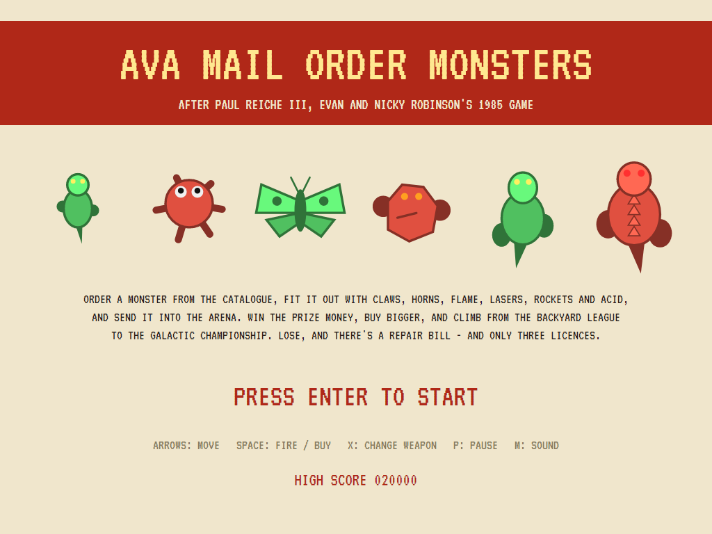
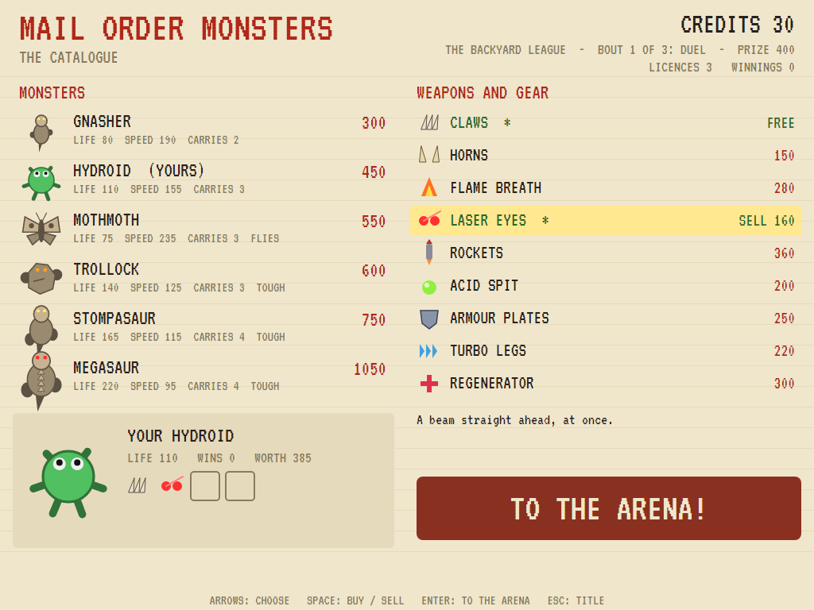
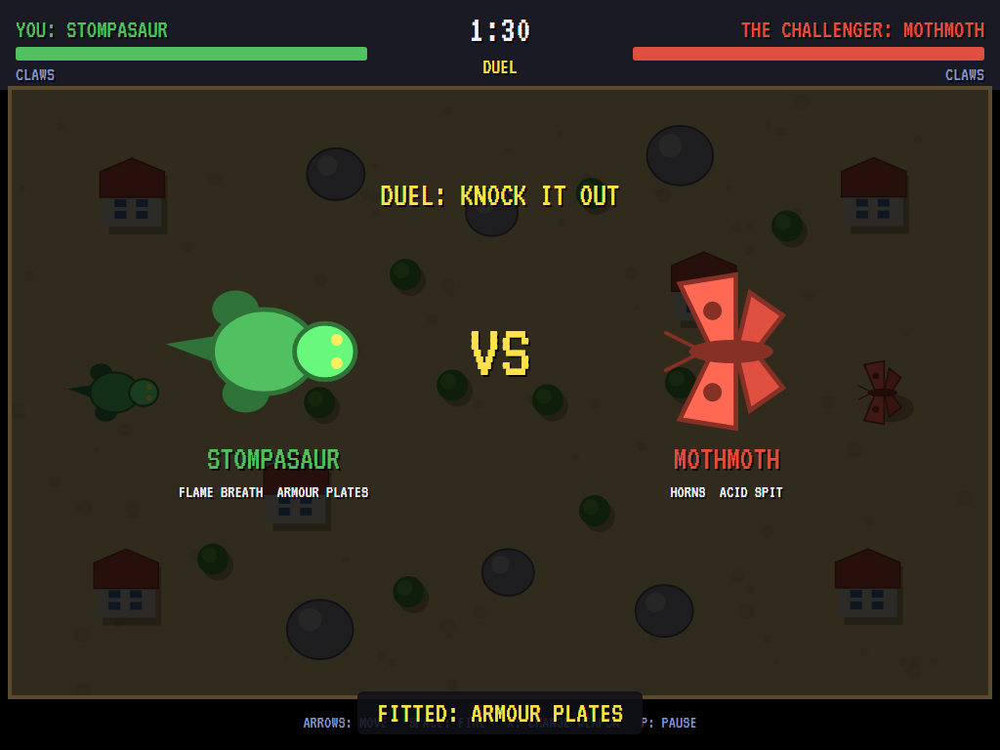
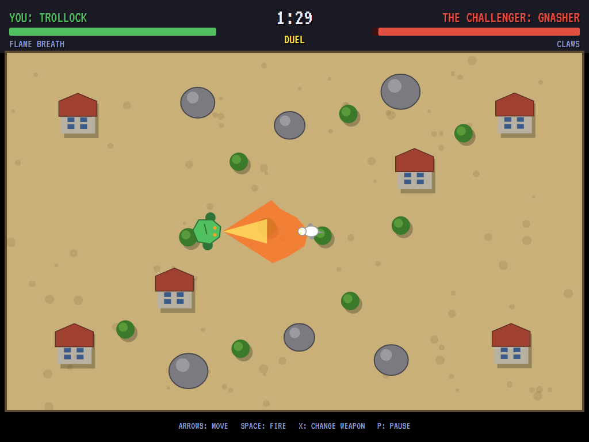
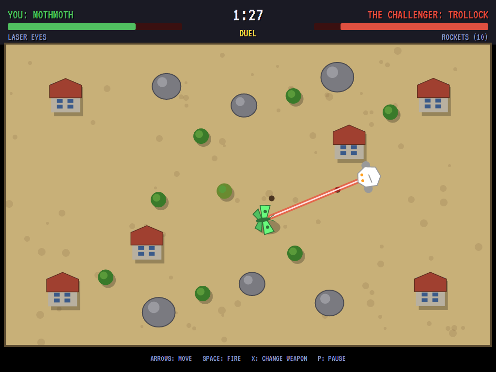
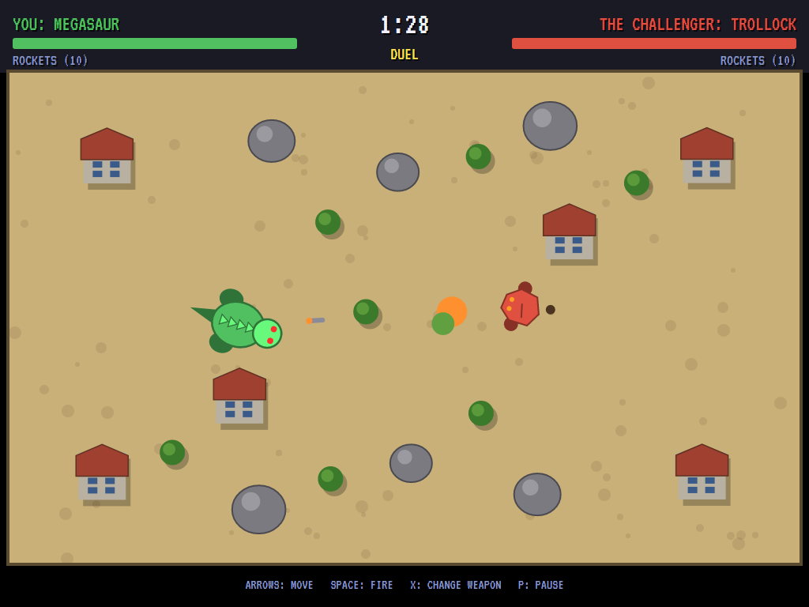
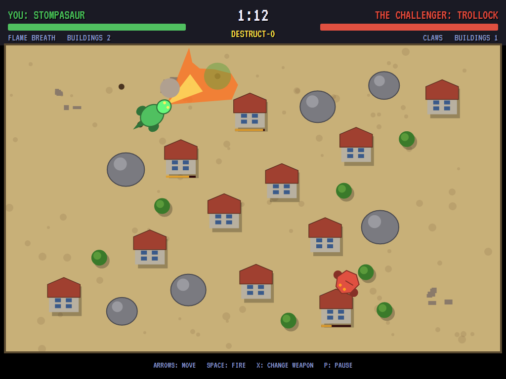
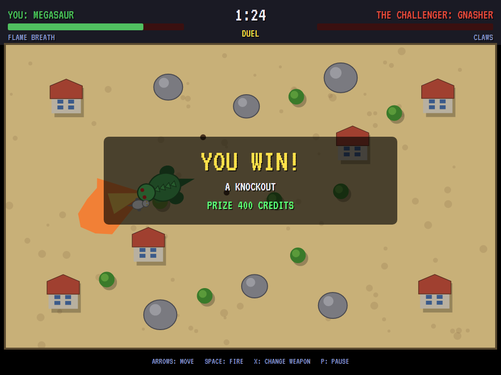
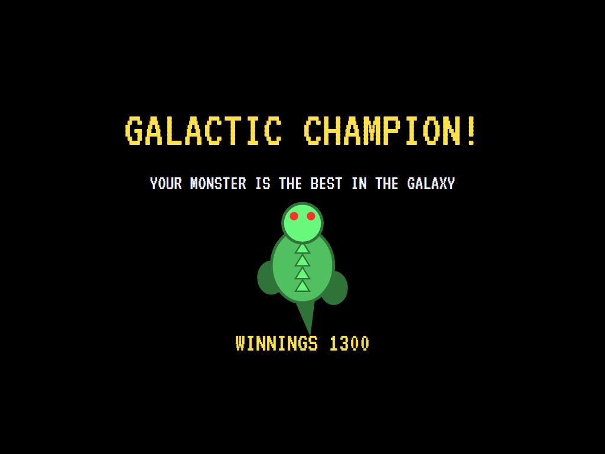
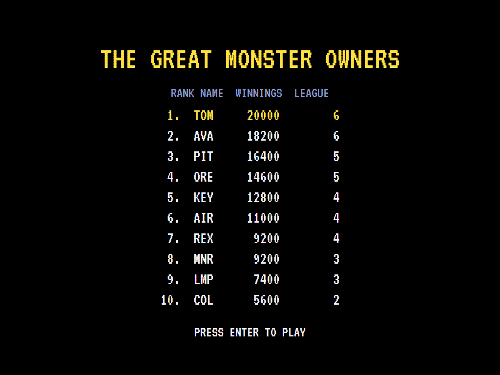

# AVA Mail Order Monsters

[](https://github.com/Harlock123/AVAMailOrderMonsters/actions/workflows/build.yml)

A monster-fighting career in the style of Paul Reiche III, Evan and Nicky Robinson's 1985 Electronic Arts
game **Mail Order Monsters**, built with .NET 10 and Avalonia UI. Order a monster from the catalogue, fit
it out with claws, horns, flame, lasers, rockets and acid, and send it into the arena. Win the prize money,
buy bigger, and climb from the Backyard League to the Galactic Championship. Lose, and there's a repair
bill, and you only have three licences.

## Features

- **The catalogue**: six monsters, each with its own life, speed and carrying capacity.
  - **Gnasher**: a quick lizard that carries two things.
  - **Hydroid**: a tentacled sea beast.
  - **Mothmoth**: a giant moth, fast and frail, that flies over rocks and buildings.
  - **Trollock**: a thick-skinned troll of rock.
  - **Stompasaur**: a big dinosaur.
  - **Megasaur**: the biggest thing in the catalogue, which carries four.
- **Weapons**:
  - **Claws**: free, up close.
  - **Horns**: a headlong charge and a butt.
  - **Flame breath**: a cone of fire while it's held, and it burns trees down.
  - **Laser eyes**: a beam down the line, at once; rocks stop it.
  - **Rockets**: they burst where they hit, and there are twelve a bout.
  - **Acid spit**: it slows what it hits.
- **Gear**: **armour plates** take a quarter off every blow, **turbo legs** make a monster a third faster,
  and a **regenerator** heals as it fights.
- **Selling and trading in**: everything sells back at half price. Trade a monster in for a bigger one
  and its fittings move over while there's room.
- **Two kinds of bout**: the **Duel**, won by a knockout or on points when the clock runs out, and
  **Destruct-o**, won by flattening the most buildings. The second bout of every league is Destruct-o.
- **The arena**: rocks stop walkers (fliers pass over), trees burn and fall, buildings crumble. Every
  arena is mirrored, so neither side has the better ground. Weapons aim themselves at the other monster
  when it's near the way yours is facing.
- **The career**: four leagues of three bouts. Each league's challengers have more to spend and handle
  their monsters better, and each league pays a bigger prize. Each win toughens your monster a little.
  A loss costs a licence and a repair bill (a fifth of what the monster cost). Fittings are sold off to pay
  it if need be, and bankruptcy is the end.
- **The attract mode** shows the computer at it: shopping, upgrading, and fighting. The computer's
  handler picks the weapon that suits the distance, keeps that weapon's range while circling, and steers
  round obstacles. In Destruct-o it goes for the nearest building and fights only when the other monster
  comes close.

## Screenshots

| The title | The catalogue | The challenger |
|:---------:|:-------------:|:--------------:|
|  |  |  |
| Six monsters to choose from. | A Hydroid with laser eyes. | A Stompasaur against a Mothmoth. |

| Flame breath | Laser eyes | Rockets |
|:------------:|:----------:|:-------:|
|  |  |  |
| A Trollock breathes fire. | A Mothmoth's beam. | A Megasaur's barrage. |

| Destruct-o | The result | Champion |
|:----------:|:----------:|:--------:|
|  |  |  |
| Flattening the town. | The prize money. | The best in the galaxy. |



The screenshots are made by the tests, which play the game in a real (headless) window; see
[Tests](#tests).

## Download and run

Ready-to-run builds for Windows, macOS and Linux, on both Intel/AMD and ARM, are on the
[Releases page](https://github.com/Harlock123/AVAMailOrderMonsters/releases/tag/latest). **Latest build**
is rebuilt on every push to `main`. Each download is one self-contained executable: no .NET install is
needed.

| Platform | Archive |
|---|---|
| Windows | `AVAMailOrderMonsters-win-x64.zip`, `AVAMailOrderMonsters-win-x86.zip`, `AVAMailOrderMonsters-win-arm64.zip` |
| macOS | `AVAMailOrderMonsters-osx-arm64.tar.gz` (Apple silicon), `AVAMailOrderMonsters-osx-x64.tar.gz` (Intel) |
| Linux | `AVAMailOrderMonsters-linux-x64.tar.gz`, `AVAMailOrderMonsters-linux-arm64.tar.gz`, `AVAMailOrderMonsters-linux-arm.tar.gz` |

```bash
tar -xzf AVAMailOrderMonsters-linux-x64.tar.gz     # or linux-arm64, linux-arm, osx-arm64, osx-x64
./AVAMailOrderMonsters
```

On Windows, unzip and run `AVAMailOrderMonsters.exe`. On macOS, if Gatekeeper refuses to open it, run
`xattr -d com.apple.quarantine AVAMailOrderMonsters` once. Run with `--no-audio` for silence.

**Sound** comes through OpenAL Soft, built in for every platform. In a virtual machine the game
detects it and uses a larger audio buffer, so the sound doesn't break up.

**Gamepads** use SDL2, which is bundled for Windows, macOS and Intel/AMD Linux. ARM Linux builds need it
installed; without it the keyboard still works:

```bash
sudo apt install libsdl2-dev            # Debian / Ubuntu / Raspberry Pi OS
sudo pacman -S --needed sdl2-compat     # Arch / Omarchy
```

## Controls

| Action | Keyboard | Gamepad |
|---|---|---|
| Start | Enter or 1 | Start |
| Move (and choose in the catalogue) | Arrows or W/A/S/D | Left stick / D-pad |
| Fire (and buy or sell) | Space, Z or Ctrl | A or right trigger |
| Change weapon | X or Shift | B or X |
| To the arena (from the catalogue) | Enter | Start |
| Pause | P or Esc | Start or Back |
| Sound on/off | M | |
| Screenshot | Ctrl+S (to your Pictures folder) | |

On the high-score table, type your initials, or use up/down and Space, then Enter.

## Tests

```bash
dotnet test AVAMailOrderMonsters.slnx
```

The game runs in fixed 60 Hz steps, so it plays the same at any frame rate. The tests check:

- **The catalogue**: buying a monster, fitting it out (only as much as it can carry) and selling back at
  half price; trading in for a bigger monster and keeping its fittings; the shop's cursor and buttons.
- **The arena**:
  - claws striking only close and in front;
  - a laser hitting at once down the line, stopped by a rock;
  - a rocket's burst, and only twelve of them;
  - acid slowing what it hits;
  - flame burning in a cone and burning a tree down;
  - horns charging and butting;
  - armour and the regenerator;
  - a flier crossing rocks that stop a walker;
  - turbo legs;
  - a knockout and a win on points;
  - Destruct-o won by buildings flattened.
- **The career**: a win paying the prize, and three wins a promotion; a loss costing a licence and the
  repair bill, with the bout fought again; fittings sold off for repairs, and bankruptcy the end; the
  championship won and the high-score table; Destruct-o every second bout; the demonstration; pause; the
  keys, through to the monster.
- **Whole careers**: the computer's shopping and handling win the Galactic Championship more often than
  not (and always get past the City League). Standing still in the arena loses everything. Each league's
  challengers are tougher than the last.

`tests/AVAMailOrderMonsters.Tests/PilotProbe.cs` reports how whole computer careers go, bout by bout, for
tuning (`MONSTER_PROBE=1`; `MONSTER_PROBE=lazy` for a monster left standing).

The screenshot tests draw the real screen in a headless window. To refresh the README's pictures:

```bash
MONSTER_SHOTS=$PWD/Images dotnet test tests/AVAMailOrderMonsters.Tests --filter ScreenshotTests
```

## Building

```bash
dotnet build AVAMailOrderMonsters.slnx
dotnet run --project src/AVAMailOrderMonsters
```

Needs the .NET 10 SDK. The sounds and tunes are made by `tools/make_sounds.py` (standard-library Python):
`python3 tools/make_sounds.py` rewrites `src/AVAMailOrderMonsters/Sounds`.

## Project structure

```
AVAMailOrderMonsters/
├── AVAMailOrderMonsters.slnx
├── src/AVAMailOrderMonsters/
│   ├── Engine/
│   │   ├── GameEngine.cs        # States, the shop, the career through the leagues, the title and demonstration
│   │   ├── Catalog.cs           # The monsters, weapons and gear, a monster's loadout, and the leagues
│   │   ├── Arena.cs             # A bout: the arena's rocks, trees and buildings, the monsters, the shots
│   │   ├── Sim.cs               # A bout step by step: moving, every weapon, armour and regeneration, the result
│   │   ├── Brain.cs             # The computer's handler in the arena, and its shopping
│   │   ├── HighScoreTable.cs, InitialsEntry.cs
│   │   ├── InputHandler.cs, ControllerManager.cs  # Keys and an SDL2 gamepad
│   │   └── SoundManager.cs      # Effects and tunes through OpenAL
│   ├── Audio/                   # The OpenAL engine (from the author's AVABand)
│   ├── Views/                   # The catalogue page, the arena from above, the monsters, the title
│   └── Sounds/                  # The synthesised effects and tunes
├── tests/AVAMailOrderMonsters.Tests/  # Gameplay, career and screenshot tests
├── tools/make_sounds.py
└── Images/                      # Screenshots
```

## About and licence

AVA Mail Order Monsters © 2026 Lonnie Watson, under the [MIT License](LICENSE).

*Mail Order Monsters* © 1985 Electronic Arts, by Paul Reiche III, Evan Robinson and Nicky Robinson; the name
belongs to its current owner. AVA Mail Order Monsters is an independent, unofficial game in its style. Its
monsters, weapons, arenas, graphics, sounds, tunes and code are its own; nothing is taken from the original
game's program, graphics or sound. It is not affiliated with or endorsed by any rights holder.
